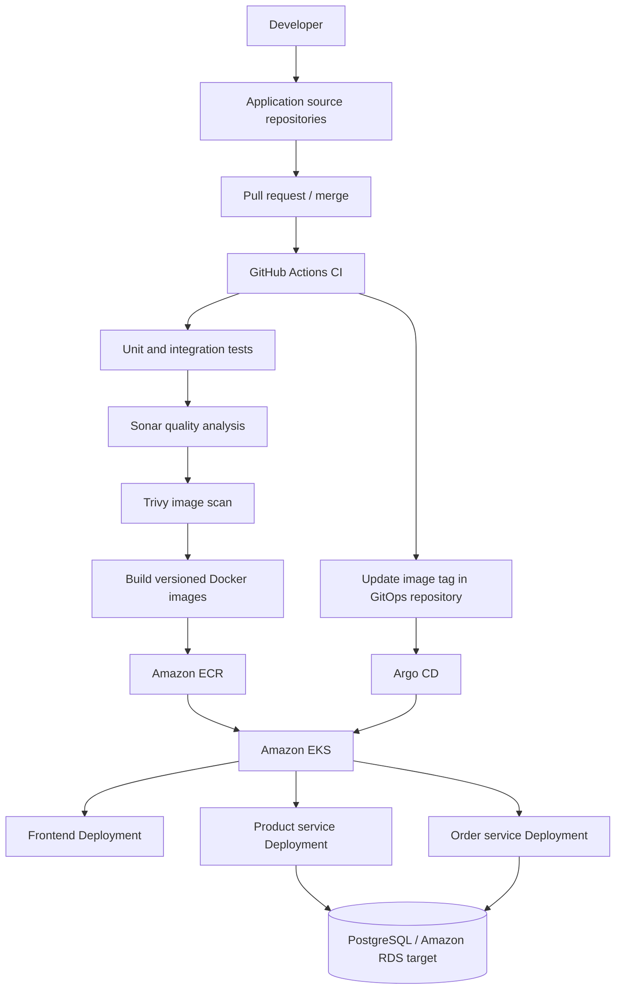
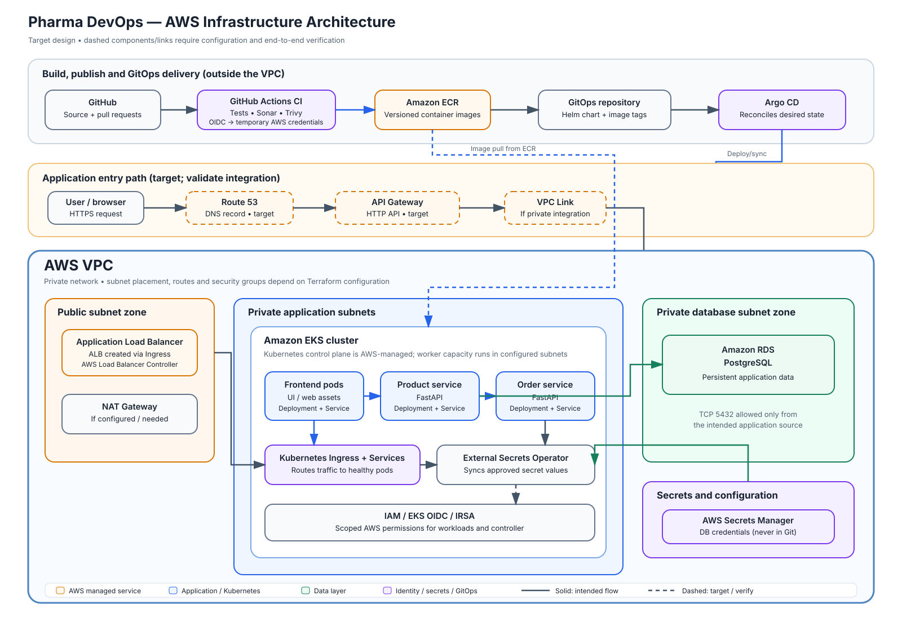
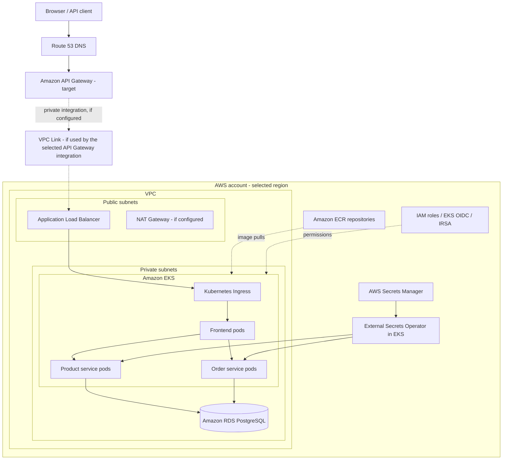
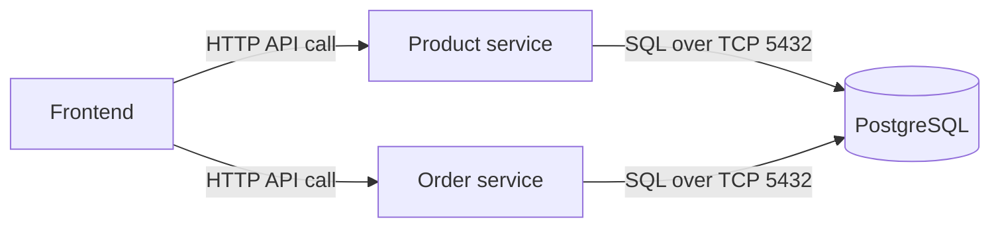
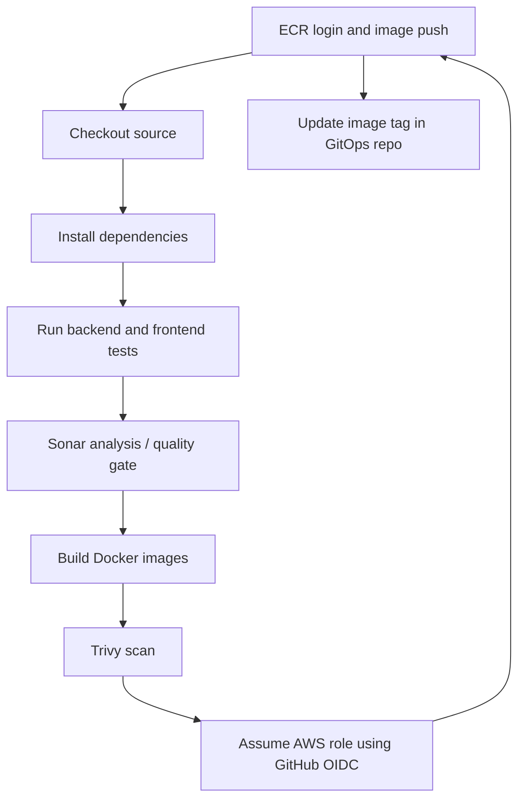
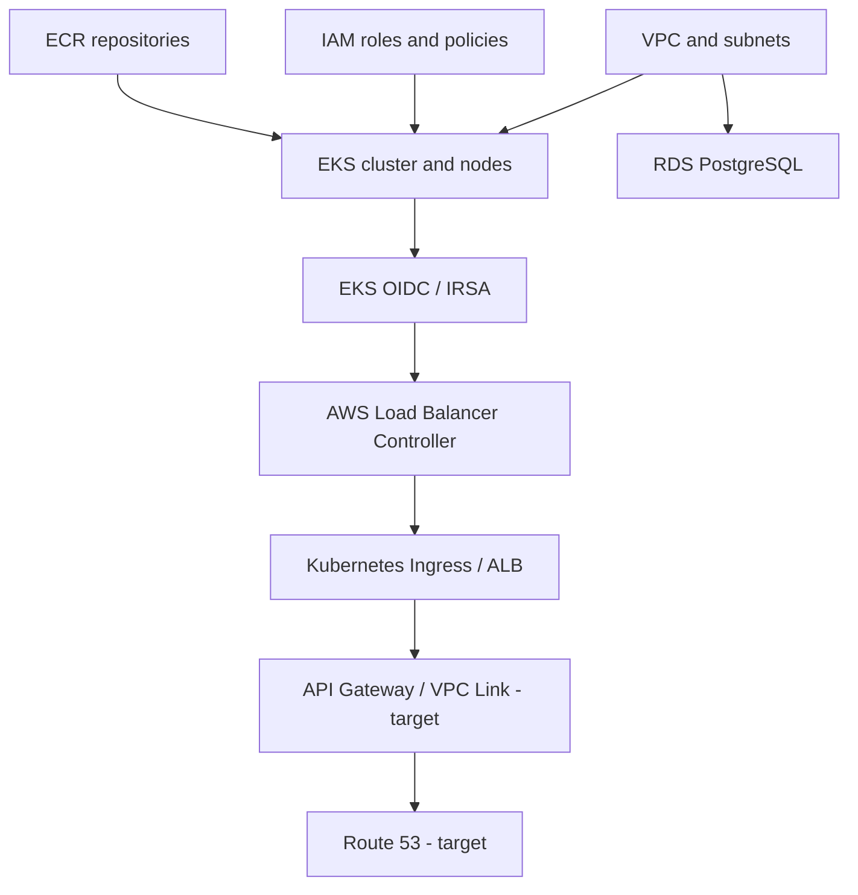
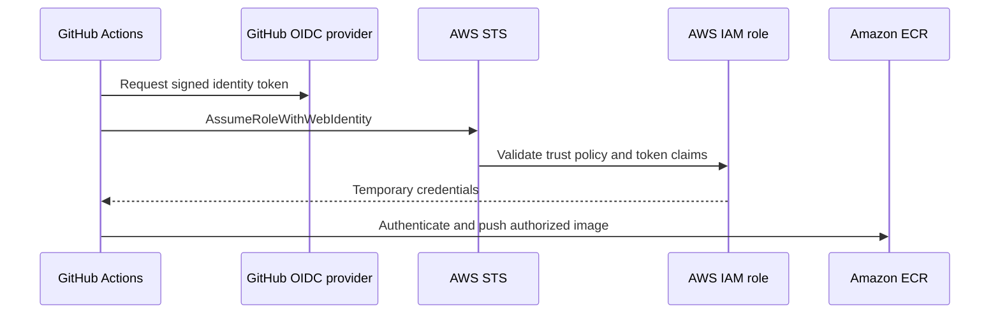
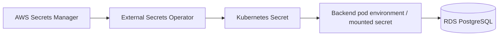

# MedInvo DevOps Microservices Platform

A learning-focused, end-to-end DevOps project that takes a multi-service application from local development to AWS using containers, Kubernetes, Infrastructure as Code, CI/CD, GitOps, security scanning, and managed PostgreSQL.

> **Project status note:** This README documents the intended end-to-end architecture and the progress recorded during implementation. It distinguishes confirmed work from planned or not-yet-verified components. Always validate the live AWS account, Terraform plan/state, GitHub Actions runs, and Argo CD health before treating a component as production-ready.

---

## Contents

- [1. Project goals](#1-project-goals)
- [2. Application overview](#2-application-overview)
- [3. Technology stack](#3-technology-stack)
- [4. High-level architecture](#4-high-level-architecture)
- [5. AWS infrastructure architecture](#5-aws-infrastructure-architecture)
- [6. Request and data flow](#6-request-and-data-flow)
- [7. CI and CD workflow](#7-ci-and-cd-workflow)
- [8. Repository and project structure](#8-repository-and-project-structure)
- [9. Terraform modules and dependencies](#9-terraform-modules-and-dependencies)
- [10. Security and secrets](#10-security-and-secrets)
- [11. Testing and quality gates](#11-testing-and-quality-gates)
- [12. Local development](#12-local-development)
- [13. Deployment lifecycle](#13-deployment-lifecycle)
- [14. Operations and troubleshooting](#14-operations-and-troubleshooting)
- [15. Current implementation status](#15-current-implementation-status)
- [16. Design decisions and important clarifications](#16-design-decisions-and-important-clarifications)
- [17. Learning roadmap](#17-learning-roadmap)
- [18. Glossary](#18-glossary)

---

## 1. Project goals

The goal is to build and understand a realistic DevOps delivery path:

1. Develop and test the frontend and backend services locally.
2. Package each service as a Docker image.
3. Run the application locally with Docker Compose and PostgreSQL.
4. Use GitHub Actions to run tests, code-quality checks, image builds, and vulnerability scans.
5. Store versioned container images in Amazon ECR.
6. Provision AWS infrastructure using reusable Terraform modules.
7. Run the application on Amazon EKS (Elastic Kubernetes Service).
8. Use Argo CD and a separate GitOps repository to reconcile Kubernetes/Helm configuration.
9. Store application data in PostgreSQL, using Amazon RDS for the AWS deployment target.
10. Use AWS IAM and GitHub OIDC for short-lived CI credentials rather than long-lived AWS access keys.
11. Use Route 53 and API Gateway for the planned public DNS and API entry path.
12. Provide repeatable scripts and operational commands so common tasks can be performed safely.

### The core idea

**Code → Test → Scan → Build → Publish → Deploy → Verify**

The purpose is not just to make the application run; it is to understand how each part connects and who owns each resource.

---

## 2. Application overview

The application is a small pharma/inventory-style microservices application.

| Component | Responsibility |
|---|---|
| **Frontend** | User interface; calls backend APIs and displays application data. |
| **Product service** | Backend API for product-related operations. |
| **Order service** | Backend API for order-related operations. |
| **PostgreSQL** | Relational database for persistent application records. |
| **Docker Compose** | Runs the application services and database locally. |
| **Kubernetes** | Runs and restarts containers, manages replicas, service discovery, and configuration in EKS. |

The backend services are separate applications. Each should own its API routes and database access logic, and expose a clear service interface. The frontend should call the backend API rather than connect directly to PostgreSQL.

**Database note:** PostgreSQL has been used in local development. Amazon RDS for PostgreSQL is the intended managed database for AWS. The actual database-per-service model and schema ownership should be confirmed against the application code; this README does not assume that each service already has a separate database.

---

## 3. Technology stack

| Area | Technology | What it does |
|---|---|---|
| Frontend | React (as planned/used in CI notes) | Browser UI |
| Backend | Python, FastAPI | REST APIs for product and order services |
| Database | PostgreSQL | Persistent relational data |
| Application tests | `pytest`, `httpx`; frontend test tooling such as Vitest where configured | Automated tests |
| Local containers | Docker, Docker Compose | Reproducible local runtime |
| Container registry | Amazon ECR | Stores tagged Docker images |
| Container orchestration | Amazon EKS, Kubernetes | Runs application containers in AWS |
| Infrastructure as Code | Terraform | Provisions AWS infrastructure |
| CI | GitHub Actions | Tests, scans, builds, and publishes images |
| CD / GitOps | Argo CD, Helm, GitOps repository | Reconciles desired deployment state into Kubernetes |
| Image scanning | Trivy | Detects image and filesystem vulnerabilities |
| Code quality | SonarQube or SonarCloud, depending on configured service | Static analysis and quality gates |
| AWS identity for CI | IAM + GitHub OIDC | Federated, short-lived AWS credentials |
| Load balancing | AWS Load Balancer Controller + ALB (target design) | Connects external/internal HTTP traffic to Kubernetes services |
| Secrets | AWS Secrets Manager + External Secrets Operator (target/recorded GitOps setup) | Delivers secrets to Kubernetes without committing values |
| Database hosting | Amazon RDS for PostgreSQL (target) | Managed PostgreSQL |
| DNS | Amazon Route 53 (target) | DNS records for the application domain |
| API entry point | Amazon API Gateway (target) | API routing and policy boundary |
| Terraform state | S3 remote backend (recorded in infrastructure work) | Shared remote Terraform state |
| Repeatable operations | Python scripts and shell commands | Automates repeatable workflows |

> Use the exact tool variant configured in the repositories. For example, SonarCloud and self-hosted SonarQube are related but different deployment choices.

---

## 4. High-level architecture



### Two separate flows

**CI (continuous integration)** validates source code and creates trusted, versioned images.

**CD (continuous delivery/deployment)** uses GitOps configuration to tell Argo CD which versions and Kubernetes resources should run.

ECR stores the images. It does not deploy them. Argo CD does not build the images. GitHub Actions and Argo CD have different responsibilities.

---

## AWS infrastructure diagram (SVG)

The vector diagram below shows the target AWS network, application runtime, database, secret delivery, and delivery pipeline. It can be zoomed without losing clarity. Dashed boxes or connections indicate planned integrations that must be verified against the live Terraform state and AWS configuration.



Open the standalone vector file: [`docs/aws-infrastructure-architecture.svg`](docs/aws-infrastructure-architecture.svg).

## 5. AWS infrastructure architecture

The following is the **target AWS design**. The API Gateway and Route 53 Terraform modules were recorded as existing but not yet called from the `dev` root module in the Phase 6 notes. Therefore, do not interpret the entire diagram as proof that all routes are currently live.



### Network boundaries

- **VPC:** private network boundary for the AWS application resources.
- **Public subnets:** typically host public-facing load balancer components and/or NAT infrastructure according to the chosen design.
- **Private subnets:** intended for EKS worker nodes/pods and RDS, subject to the actual subnet and routing configuration.
- **Security groups:** should allow only required traffic. In particular, PostgreSQL should accept TCP `5432` only from the intended application security group or narrowly scoped network source.
- **NAT Gateway:** allows private resources to make outbound connections when required; it can add material cost.
- **EKS control plane:** AWS-managed Kubernetes control plane; worker capacity runs in the configured node group or compute mode.
- **RDS:** should not be exposed publicly unless there is a specific, reviewed reason to do so.

### Important API Gateway / ALB distinction

API Gateway and an ALB are not automatically connected simply because both exist. The integration must be configured explicitly. A common private design is:

`Route 53 → API Gateway → VPC Link → private ALB → Kubernetes Ingress/Services`

This is a **target pattern**, not a claim that it is already working. Verify the API Gateway integration type, VPC Link, ALB scheme, Ingress, and Route 53 alias before relying on this path. For a public frontend, decide whether the frontend should be served through the same gateway or through a separate public entry point.

---

## 6. Request and data flow

### A. A user request

1. A user opens the configured domain in a browser.
2. Route 53 resolves the domain to the configured application entry point.
3. The selected public entry point (target: API Gateway and its configured integration) forwards traffic to the load-balancing layer.
4. The AWS Load Balancer Controller provisions/reconciles an ALB from the Kubernetes Ingress, if that controller and Ingress are configured.
5. Kubernetes routes traffic through a Service to healthy frontend or backend pods.
6. The frontend calls the product or order API.
7. The backend service validates the request, performs its business logic, and reads/writes PostgreSQL.
8. The API returns a response to the frontend, which updates the UI.

### B. Database connectivity



- The browser should never receive database credentials.
- The browser should never connect directly to PostgreSQL.
- Database connection details belong in server-side configuration.
- In AWS, backend services should use the RDS endpoint, database name, username, and password supplied securely.
- Local development may use a Docker Compose PostgreSQL service or a local PostgreSQL installation; keep local and AWS configuration separate.

### C. Image delivery

1. CI builds an image from a service's Dockerfile.
2. CI scans the image with Trivy.
3. On passing required checks, CI pushes the image to its ECR repository with a traceable tag (prefer a commit SHA over relying only on `latest`).
4. The GitOps repository is updated with that image tag.
5. Argo CD detects the GitOps change and reconciles the Helm/Kubernetes resources.
6. EKS pulls the selected image from ECR and starts the updated pods.
7. Readiness/health checks and rollout status are verified.

---

## 7. CI and CD workflow

### CI: GitHub Actions

Typical workflow stages:



Recommended guardrails:

- Run tests on pull requests before merge.
- Use `permissions: id-token: write` and narrowly scoped GitHub OIDC trust for jobs that need AWS credentials.
- Avoid long-lived AWS access keys in GitHub secrets.
- Use immutable image tags such as the commit SHA.
- Configure Trivy's fail threshold deliberately; document exceptions rather than silently ignoring findings.
- Make Sonar's quality gate an explicit merge/release condition if that is the intended policy.
- Only publish deployment images from trusted branches or release workflows.
- Keep separate workflows or jobs for Terraform infrastructure changes and application image delivery.

### CD: Argo CD and GitOps

The GitOps repository is the source of truth for the desired Kubernetes state. The recorded implementation uses a Helm chart at `charts/pharma-app`, with values such as `values.yaml` and `values-dev.yaml`, in the repository noted during implementation as `https://github.com/MedInvo/gitops.git`.

Typical path:

1. CI produces an image and pushes it to ECR.
2. A controlled workflow updates the image tag in the GitOps repository.
3. Argo CD watches the GitOps repository.
4. Argo CD renders/applies the Helm chart and Kubernetes resources.
5. Kubernetes creates/updates Deployments, Services, ConfigMaps, and external-secret resources as specified.
6. Argo CD health and Kubernetes rollout status are checked.

**GitOps rule:** change the desired state in Git and let Argo CD reconcile it. Avoid making lasting manual changes with `kubectl edit` that are not committed back to Git.

---

## 8. Repository and project structure

The project has involved application source, Terraform infrastructure, Kubernetes/Helm configuration, and a separate GitOps repository. The exact current folder names may differ across the split repositories, so treat the tree below as a **logical reference structure** and align it with the actual checked-out repositories.

```text
pharma-devops-microservices/
├── frontend/                       # React UI
│   ├── src/
│   ├── tests/                      # or colocated frontend tests
│   ├── Dockerfile
│   ├── package.json
│   └── ...
├── backend/
│   ├── product-service/
│   │   ├── app/
│   │   │   ├── main.py
│   │   │   ├── database.py
│   │   │   ├── models.py
│   │   │   └── ...
│   │   ├── tests/
│   │   ├── Dockerfile
│   │   └── requirements.txt
│   └── order-service/
│       ├── app/
│       ├── tests/
│       ├── Dockerfile
│       └── requirements.txt
├── infra/
│   └── terraform/
│       ├── environments/
│       │   └── dev/
│       │       ├── providers.tf
│       │       ├── main.tf
│       │       ├── variables.tf
│       │       ├── outputs.tf
│       │       └── terraform.tfvars
│       └── modules/
│           ├── vpc/
│           ├── ecr/
│           ├── iam/
│           ├── eks/
│           ├── rds/
│           ├── alb-controller/
│           ├── api-gateway/
│           └── route53/
├── k8s/                            # optional/direct Kubernetes manifests
├── docker-compose.yml              # local multi-container development
├── .github/
│   └── workflows/                  # CI and infrastructure workflows
├── scripts/                        # repeatable helper scripts
├── README.md
└── .gitignore
```

The separate GitOps repository is expected to contain deployment configuration, for example:

```text
gitops/
├── charts/
│   └── pharma-app/
│       ├── Chart.yaml
│       ├── templates/
│       │   ├── deployments.yaml
│       │   ├── services.yaml
│       │   ├── configmap.yaml
│       │   ├── ingress.yaml
│       │   └── externalsecret.yaml
│       └── values.yaml
├── values-dev.yaml                 # if maintained outside the chart
└── argocd/
    └── application.yaml
```

This is illustrative: keep only the files that actually exist. In particular, don't duplicate Kubernetes resources between direct `k8s/` manifests and Helm templates unless their ownership is clear.

### Suggested ownership by repository/folder

| Area | Owns |
|---|---|
| Frontend source | UI code, frontend tests, frontend Dockerfile |
| Backend source | Product/order APIs, backend tests, service Dockerfiles |
| Terraform | AWS infrastructure resources and infrastructure outputs |
| GitHub Actions | CI checks, trusted image publishing, Terraform plan/apply workflow |
| GitOps repo | Desired Kubernetes/Helm configuration and image tags |
| Scripts | Safe, repeatable developer/operator workflows |
| README/docs | Setup instructions, diagrams, troubleshooting and runbooks |

---

## 9. Terraform modules and dependencies

Terraform creates cloud infrastructure. Kubernetes/Helm/Argo CD deploy application workloads. Keep those responsibilities separate.

### Modules recorded in the Terraform project

| Module | Responsibility | Dependency / integration |
|---|---|---|
| `vpc` | VPC, subnets, routes, and related network resources | Foundational network for EKS, ALB, and RDS |
| `ecr` | ECR image repositories | Independent of VPC; CI needs repository URLs and IAM permissions |
| `iam` | IAM roles/policies, including CI identity and cluster-related roles as implemented | GitHub OIDC trust must match the actual repository, branch/environment, audience, and provider |
| `eks` | EKS cluster and compute resources as implemented | Uses VPC subnet IDs and cluster/node IAM roles |
| `rds` | PostgreSQL instance, subnet group, and DB security group as implemented | Uses VPC subnets and networking/security configuration |
| `alb-controller` | IAM/IRSA-related resources for AWS Load Balancer Controller as implemented | Depends on EKS cluster identity/OIDC; controller installation may be managed separately by Helm |
| `api-gateway` | API Gateway resources as implemented in the module | Must be called from the root module and wired to the chosen backend integration |
| `route53` | DNS record resources as implemented in the module | Needs the actual hosted zone/domain and the target endpoint |

### Dependency overview



This is a conceptual dependency map. Terraform's actual dependency graph is determined by references between resources/modules and explicit `depends_on` relationships, not by diagram order alone. Route 53 usually points to the chosen entry point; it is not a prerequisite for creating EKS.

### Terraform workflow

From the development environment directory, use the commands that match the existing backend and workspace configuration:

```bash
terraform fmt -recursive
terraform init
terraform validate
terraform plan
```

Apply only after reviewing the plan and confirming account, region, cost, and destructive changes:

```bash
terraform apply
```

Useful rules:

- Store shared Terraform state in the configured S3 backend; protect it and enable appropriate state recovery controls.
- Do not commit state files, credentials, `.tfvars` containing secrets, or plan files containing sensitive values.
- Use modules for reusable infrastructure and `environments/dev` for environment-specific wiring.
- Keep one owner per resource. Don't create the same ALB, API Gateway, DNS record, or Kubernetes object independently through Terraform, scripts, and Helm.
- Never use `terraform destroy` as a generic cleanup command without reviewing the impact on shared state, ECR, RDS data, DNS, and other resources.

---

## 10. Security and secrets

### GitHub OIDC

The intended CI authentication path is:



For OIDC to work, all of these must agree:

- The AWS IAM OIDC provider exists for GitHub Actions.
- The IAM role trust policy matches the correct GitHub organization/repository and branch or GitHub environment.
- The token audience is correct (commonly `sts.amazonaws.com`).
- The workflow grants `id-token: write`.
- The role has only the permissions needed by that job.

A local `aws configure` login does **not** fix OIDC inside GitHub-hosted runners. The runner obtains its own token and assumes the configured role.

### Application secrets

The recorded GitOps work includes `ClusterSecretStore` and `ExternalSecret` resources. The intended secret flow is:



- Store real database credentials in AWS Secrets Manager for the AWS environment.
- Use IAM/IRSA permissions so the secret controller can read only the required secret.
- Keep credentials out of Git, Docker images, frontend bundles, logs, and screenshots.
- Kubernetes `Secret` objects are not automatically encrypted in every context just because they are type `Opaque`; access controls and encryption-at-rest settings matter.
- `ConfigMap` is for non-secret configuration; `Secret` is for sensitive values. Do not print secret values while debugging.
- For local development, use a local `.env` file excluded by `.gitignore`, or another local secret mechanism. Provide a safe `.env.example` with placeholders only.

### Image and code security

- **Trivy:** scans container images and can also scan source files/configuration if configured.
- **SonarQube/SonarCloud:** analyzes code quality, maintainability, and supported security rules.
- **IAM least privilege:** CI, EKS nodes, workload identities, and External Secrets should each have distinct permissions appropriate to their task.
- **Network restrictions:** RDS should accept only intended application traffic, typically TCP 5432 from a narrowly scoped security-group source.

---

## 11. Testing and quality gates

### Backend tests

The Python services use a FastAPI-style stack with dependencies such as `pytest`, `httpx`, SQLAlchemy, and a PostgreSQL driver in the recorded development work.

Typical local test pattern (run from the relevant service directory and activate the project's virtual environment first):

```bash
python -m pytest -q
```

A service's tests should cover:
- API success responses and expected status codes.
- Request validation and malformed inputs.
- Product/order business rules.
- Database operations, using a controlled test database or test fixtures.
- Error paths and dependency failures.

### Frontend tests

Run the commands defined by the frontend's `package.json`. The project notes mention Vitest as the frontend test tool where configured; verify the actual script names before running commands.

### CI quality gates

A healthy pipeline should fail when a required check fails:

1. Dependency installation.
2. Unit tests.
3. Integration tests where configured.
4. Sonar analysis / quality gate.
5. Docker build.
6. Trivy vulnerability scan and policy threshold.
7. Image push to ECR only after required checks pass.
8. GitOps image-tag update only after publishing succeeds.

Testing should not require production credentials. Use fixtures or a dedicated test database and never point automated destructive tests at production RDS.

---

## 12. Local development

The first milestone is a working local application before AWS deployment.

### Prerequisites

Install the tools used by the repositories: Git, Docker Desktop/Engine with Compose, Python version required by the backend, Node.js/npm for the frontend, and (when needed) `kubectl`, `kind`, AWS CLI, Terraform, Helm, and Argo CD CLI.

### Local flow

1. Clone the application repositories.
2. Create the local environment file from the example file, if provided.
3. Start PostgreSQL and services with the repository's Docker Compose file.
4. Confirm containers are healthy.
5. Run backend and frontend tests.
6. Open the frontend and verify that product/order data comes from the APIs.
7. Verify that created records persist in PostgreSQL.
8. Inspect service logs if the UI and database disagree.

Typical commands (adjust paths and service names to the actual Compose file):

```bash
docker compose config
docker compose up --build -d
docker compose ps
docker compose logs -f
docker compose down
```

To inspect PostgreSQL, connect using the configured local database/user and run a read-only query against the correct table. Do not assume that a running database container is automatically the database used by every backend service: confirm the connection URL/environment variables.

### Local Kubernetes

A local `kind` cluster was used in earlier validation. Keep local Kubernetes separate from AWS EKS contexts:

```bash
kubectl config get-contexts
kubectl config current-context
kubectl get pods -n pharma-app
kubectl get services -n pharma-app
kubectl describe pod <pod-name> -n pharma-app
kubectl logs <pod-name> -n pharma-app
```

Set the intended context explicitly before applying or deleting resources. Port-forward to the actual Service port, not an assumed container port.

---

## 13. Deployment lifecycle

### First deployment

1. **Local app:** make sure the UI, APIs, database, and tests work.
2. **Docker:** build and run each service image locally.
3. **Terraform review:** inspect variables, module wiring, backend configuration, and plan.
4. **AWS foundation:** provision VPC/subnets, IAM, ECR, EKS, and RDS according to the approved plan.
5. **Cluster access:** configure `kubectl` for the correct EKS cluster and namespace.
6. **Cluster add-ons:** install/configure the AWS Load Balancer Controller and External Secrets Operator if they are part of the chosen design.
7. **GitOps:** configure Argo CD to track the correct GitOps repository and environment values.
8. **CI:** verify GitHub OIDC and pipeline permissions; run tests and scans.
9. **Publish:** push versioned images to the correct ECR repositories.
10. **Deploy:** update the GitOps image tag and let Argo CD reconcile.
11. **Expose:** wire Ingress/ALB, API Gateway integration, and Route 53 only after validating the intended traffic path.
12. **Verify:** check Argo CD application health, pod readiness, service endpoints, logs, API behavior, and database persistence.

### Repeat deployments

The intended repeatable path is:

`Code change → CI checks → ECR image tag → GitOps commit → Argo CD sync → rollout verification`

Terraform changes should go through a separate reviewed infrastructure plan/apply process. Application releases should not recreate the VPC or EKS cluster.

---

## 14. Operations and troubleshooting

### Fast checks

```bash
# Docker
docker compose ps
docker compose logs --tail=100

# Kubernetes
kubectl config current-context
kubectl get pods,svc,deploy,ingress -n pharma-app
kubectl get events -n pharma-app --sort-by=.lastTimestamp
kubectl describe pod <pod-name> -n pharma-app
kubectl logs <pod-name> -n pharma-app --all-containers=true --tail=100

# EKS / AWS
aws sts get-caller-identity
aws eks list-clusters --region us-east-1
aws ecr describe-repositories --region us-east-1

# Terraform (from the correct environment directory)
terraform fmt -recursive
terraform validate
terraform plan
```

Use the AWS region configured for your environment; `us-east-1` is the region recorded for the ECR repositories in this project.

### Common issues

| Symptom | What to check |
|---|---|
| Frontend does not show new DB records | Frontend API URL, backend endpoint, service selectors, API response, database URL, correct table/schema, CORS, browser network tab |
| `kubectl port-forward` says Service has no port | Run `kubectl get svc -n pharma-app`; forward using the Service's declared port |
| Pod cannot start | `kubectl describe pod`, events, image name/tag, ECR pull permissions, probes, ConfigMaps/Secrets |
| Backend cannot connect to PostgreSQL | DB endpoint/name/user, secret reference, security groups, route/subnets, DNS, port 5432 |
| GitHub OIDC role assumption fails | OIDC provider, trust policy `sub` and `aud`, repo/branch/environment, `id-token: write`, role ARN, IAM permissions |
| Argo CD is OutOfSync or Progressing | GitOps repo/path/branch, Helm values, sync events, pod readiness, image tag, external secret status |
| Terraform state lock error | Confirm no active Terraform run, inspect the configured backend/locking mechanism, and recover carefully; never force-unlock a lock held by another active run |
| DNS does not resolve to app | Hosted zone, record type, target hostname, alias/TTL, API Gateway/ALB integration, certificate and domain configuration |

### Python helper scripts

Use scripts for repetitive, well-defined operations such as checking prerequisites, selecting a known Kubernetes context, running tests, or displaying service status. Scripts should:
- Fail fast on command errors.
- Print the command being run.
- Never echo secrets.
- Require confirmation before destructive actions.
- Avoid creating duplicate AWS resources that Terraform already owns.
- Avoid automatically applying Terraform without an explicit review step.

---

## 15. Current implementation status

This table reflects the progress captured in the project notes available when this README was prepared. It is not a live AWS audit.

| Component | Recorded status | Notes |
|---|---|---|
| Frontend, product service, order service | Implemented for local development | Docker Compose and local Kubernetes work were discussed; verify current branch/repo state |
| PostgreSQL locally | Used in development | Local DB and backend connection issues were debugged earlier |
| Docker images | Built and used | Image names/tags have changed over time; use the current repository configuration |
| Local Kubernetes namespace `pharma-app` | Used | Pods/services were observed running during earlier validation |
| ECR | Repositories recorded | `pharma-medinvo-dev-frontend`, `pharma-medinvo-dev-product-service`, `pharma-medinvo-dev-order-service` in `us-east-1` |
| Terraform module directories | Present in notes | `vpc`, `ecr`, `iam`, `eks`, `rds`, `alb-controller`, `api-gateway`, `route53` |
| VPC/EKS/RDS Terraform wiring | In progress / needs code validation | Review actual module code and current plan/state before making claims about live resources |
| GitHub Actions OIDC | Troubleshooting was recorded | A prior `AssumeRoleWithWebIdentity` failure was reported; re-test the current workflow |
| Argo CD + Helm GitOps | Setup and sync activity recorded | `charts/pharma-app`, environment values, `ClusterSecretStore`, and `ExternalSecret` were mentioned; health was still `Progressing` in the recorded session |
| AWS Secrets Manager → External Secrets | Configuration work recorded | Confirm secret exists, IAM permissions work, and ExternalSecret reports Ready |
| API Gateway Terraform module | Module exists | Phase 6 notes state it was not called by the `dev` root module |
| Route 53 Terraform module | Module exists | Phase 6 notes state it was not called by the `dev` root module |
| Trivy | Planned/CI design | Confirm workflow runs and policy threshold |
| SonarQube/SonarCloud | Planned/CI design | Confirm configured provider/project and quality gate |
| Route 53 + API Gateway public path | Target architecture | Do not publish as working until end-to-end DNS and routing are verified |
| RDS application connectivity | Target/needs verification | Verify deployed RDS endpoint, secrets, security groups, and application health |

**How to update this section:** after each phase, replace the status with evidence: a passing workflow URL, successful Terraform output, healthy Argo CD application, successful endpoint test, or database query result. Avoid marking a component complete based only on a module or YAML file existing.

---

## 16. Design decisions and important clarifications

### EKS versus ECS

Both are AWS container orchestration services, but they solve overlapping runtime needs:

- **EKS** runs Kubernetes workloads and is the selected runtime for this project's frontend and backend services.
- **ECS** is a separate AWS orchestration option and is not required just because the application uses containers.
- **ECR** is the image registry and can store images consumed by EKS or ECS.

For this project, keep the main application runtime on EKS unless there is a clear requirement to run a separate workload on ECS. Using both would add extra deployment and operational complexity.

### RDS versus a database pod

- Local PostgreSQL in Docker Compose is useful for development.
- A PostgreSQL pod in Kubernetes can be useful for disposable experiments, but persistent production data requires deliberate storage, backup, upgrade, and recovery planning.
- The AWS target is Amazon RDS for PostgreSQL, so EKS services should connect to RDS instead of treating a single application-cluster PostgreSQL pod as the production database.

### Terraform versus Helm/Argo CD

- Terraform owns AWS infrastructure such as VPC, EKS, ECR, RDS, IAM, and configured DNS/API resources.
- Helm/Argo CD owns desired application resources in Kubernetes.
- The AWS Load Balancer Controller reconciles supported Kubernetes Ingress/Service resources into AWS load-balancer resources.
- Avoid having two tools independently manage the same resource.

### Route 53 versus API Gateway

Route 53 resolves names; API Gateway receives and routes API requests. They are not substitutes. The DNS record must point to a real, correctly configured endpoint, and API Gateway must have an integration to the application entry point.

### Image tags

Use immutable tags (for example, a Git commit SHA) for releases. `latest` is convenient for local experiments but is ambiguous for reliable rollbacks and audit trails.

---

## 17. Learning roadmap

| Phase | Goal | Completion evidence |
|---|---|---|
| 1. Local application | Frontend, backend services, PostgreSQL work together | Add/read data through UI/API; tests pass |
| 2. Docker | Build each service and run with Compose | Clean rebuild and healthy services |
| 3. Local Kubernetes | Deploy to local cluster | Deployments and Services healthy; API/UI verified |
| 4. Kubernetes validation | Debug probes, logs, networking, configuration | Repeatable smoke-test checklist |
| 5. AWS infrastructure | Terraform VPC, IAM, ECR, EKS, RDS | Reviewed plan and successful outputs |
| 6. CI security and quality | GitHub Actions, OIDC, tests, Sonar, Trivy | Trusted workflow passes without static AWS keys |
| 7. GitOps CD | Argo CD + Helm | GitOps commit changes the running image and rollout becomes healthy |
| 8. Public access | ALB/Ingress, API Gateway, Route 53 | HTTPS endpoint works end-to-end |
| 9. Operational readiness | Health checks, logs, rollback, costs, backup strategy | Documented runbook and tested recovery path |

---

## 18. Glossary

- **API:** Application Programming Interface; the contract through which services communicate.
- **Docker image:** Immutable package containing an application and its runtime dependencies.
- **Container:** A running instance of an image.
- **ECR:** Amazon Elastic Container Registry; stores container images.
- **EKS:** Amazon Elastic Kubernetes Service; managed Kubernetes on AWS.
- **ECS:** Amazon Elastic Container Service; an alternative AWS container orchestrator.
- **Kubernetes Deployment:** Defines a desired number of application pod replicas and how they are updated.
- **Kubernetes Service:** Stable network endpoint for a set of pods.
- **Ingress:** Kubernetes resource describing HTTP/HTTPS routing into cluster services.
- **ALB:** Application Load Balancer; Layer 7 HTTP/HTTPS load balancer.
- **Terraform:** Infrastructure as Code tool for declaring and managing infrastructure.
- **GitHub Actions:** Workflow automation used for CI and infrastructure pipelines.
- **OIDC:** Identity federation that lets GitHub Actions request temporary AWS credentials.
- **Trivy:** Scanner for vulnerabilities and certain configuration/secrets issues.
- **SonarQube / SonarCloud:** Code analysis and quality-gate tools.
- **Argo CD:** Kubernetes GitOps controller that reconciles cluster state from Git.
- **Helm:** Package manager/template system for Kubernetes resources.
- **GitOps:** Operating model where Git stores the desired deployment state and a controller reconciles it.
- **RDS:** AWS managed relational database service.
- **Secrets Manager:** AWS service for storing and controlling access to sensitive values.
- **External Secrets Operator:** Kubernetes operator that syncs external secret stores into Kubernetes Secrets.
- **Route 53:** AWS DNS service.
- **API Gateway:** Managed API entry point for authentication, routing, throttling, and related API controls.
- **VPC:** Isolated virtual network in AWS.
- **IAM:** AWS identity and access management.
- **IRSA:** IAM Roles for Service Accounts; grants AWS permissions to Kubernetes workloads through EKS OIDC.

---

## Final architecture principle

Keep the ownership boundaries simple:

**Terraform provisions AWS. GitHub Actions tests and publishes. ECR stores images. Argo CD deploys the declared state. EKS runs the application. RDS stores persistent data. Route 53 and API Gateway expose the application only after their integration is configured and verified.**

The application is considered deployed only when the user-facing request succeeds end-to-end, backend services can safely reach PostgreSQL, deployment health is good, and the configuration is reproducible from the repositories.
